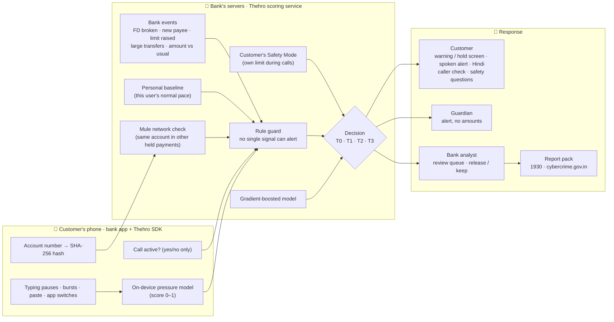
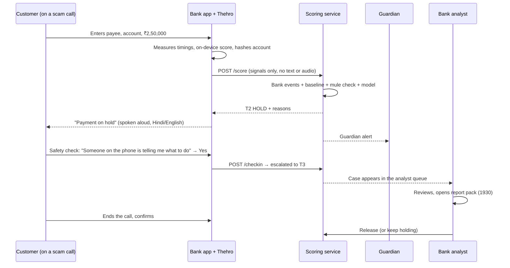

# Thehro – stop the payment, not the customer

**Coerced-payer detection for digital arrest scams**

Team ThreatForge · RAKSHAM AI Cybersecurity Hackathon (IIT Delhi × Amazon) · Track 02: AI-Driven Scam Pattern Recognition

Sameer Ahmed (team lead, Osmania University) · Bhargab Das · Bhukya Narender (IIT Jodhpur)

> *Thehro* (ठहरो) means "wait". It's a safety layer for a bank's app. It notices when a customer is paying **under pressure from a caller**, holds only that payment, and brings in someone outside the call.

---

## The problem

In a **digital arrest scam**, a fake police, CBI or customs officer keeps the victim on a voice or video call, sometimes for hours, and pushes them to "verify" their savings by transferring money. The victim pays from their own phone with their own PIN, so the bank sees a normal, authorised payment.

Most fraud controls look at the receiving account or slow down everyone's payments. **Thehro looks at the payer.** Is this person acting under pressure right now?

---

## Architecture



### One payment, end to end



---

## Features

| | Feature | What it does |
|---|---|---|
| 📞 | **Call detection** | Checks whether a normal or VoIP (WhatsApp) call is active during the payment. Yes/no only, never who is calling |
| ⌨️ | **Behaviour signals** | Pauses between fields, the account number typed in bursts (someone reading it out) or pasted, switching apps mid-payment |
| 🧠 | **On-device pressure model** | A small logistic model runs **inside the app**. Only its score leaves the phone |
| 👤 | **Personal baseline** | After 3 ordinary payments, hesitation is compared with *this user's* normal pace, not a global average |
| 🏦 | **Bank-side events** | FD broken today, new payee, transfer limit raised, repeat large transfers, amount vs usual, share of balance |
| 🕸️ | **Mule account detection** | The account number is hashed on the phone. If the same account already received other held payments, it's flagged across customers |
| 🛡️ | **Rule guard + ML model** | No single signal can raise an alert. A gradient-boosted model refines the tier within the guard |
| ⏸️ | **Tiered response** | Pass, warn, hold until the call ends, or analyst review. Only the risky payment is touched |
| 🔊 | **Spoken alert** | The hold message is read aloud, so a victim still on the call hears it |
| 🇮🇳 | **Hindi warning screen** | Title, reasons and safety advice switch to Hindi in one tap |
| 🛡️ | **Safety Mode** | The customer (or their family) sets their own rule: *hold any payment above ₹X made during a call*. Consent-based protection for senior citizens |
| 🕵️ | **"Is this caller real?"** | The user taps who the caller claims to be (CBI, Police, Customs, TRAI, Bank, RBI) and the app shows and speaks the facts: *"CBI never arrests anyone on a call… call 1930"* |
| ❓ | **Safety check** | Three yes/no questions ("Did they say you are under arrest?"). Any "yes" sends the payment to a bank officer |
| 👨‍👩‍👧 | **Guardian alert** | A family member gets an alert (no amounts, can't move money) and a one-tap message |
| 🧑‍💼 | **Analyst queue** | Live dashboard with counts, every held case, reasons, release / keep |
| 📄 | **Report pack** | A ready-to-file summary for the 1930 helpline / cybercrime.gov.in, plus a one-tap 1930 dialer in the app |
| 📊 | **Built-in evaluation** | `/metrics` scores 20,675 held-out payments and lists failure cases; `/evaluate` scores any labelled batch |

### Decision tiers

| Tier | When | What the customer sees |
|---|---|---|
| **T0 Pass** | Few or no signals | Nothing. Payment goes through |
| **T1 Warn** | 2+ signals, medium risk | Plain-language reasons, safety check, continue or cancel |
| **T2 Hold** | 3+ signals, high risk, or the customer's own Safety Mode rule | Payment held, spoken alert, guardian alerted. Released only after confirming with **no call active** |
| **T3 Review** | Highest risk and ≥ ₹1,00,000, or the customer says a caller is directing them | Held until a bank analyst reviews it |

---

## Results

### Held-out synthetic test (`GET /metrics`)

20,675 fresh payments (seed 2026) the model never saw (training seed 7), scored with the full decision logic.

| Metric | Result |
|---|---|
| Scam payments flagged (warn or hold) | **92.8%** |
| Scam payments held | **64.0%** |
| Genuine payments flagged | **1.1%** |
| Genuine payments held | **0.17%** |
| Holds that were real scams (precision) | **87.6%** |
| Scams with the call hidden, still flagged | 95.0% |
| Adaptive scams (small amounts, no call), flagged | 70.7% |
| **Main weakness:** genuine large payments flagged | 70.7% |

### Volunteer pilot (`GET /study/summary`)

2 team members, 4 runs: the same ₹5,000 payment made calmly, then while a teammate played a "CBI officer" reading the account number aloud and rushing them.

| Average per run | Normal | Under pressure |
|---|---|---|
| Pause between fields | 4.1 s | 20.4 s |
| Account number typed in bursts | 1.5 | 3.0 |
| App switches | 0 | 2.0 |
| Session length | 68 s | 170 s |
| On-device pressure score | 0.05 | 0.80 |

The on-device model flagged 1 of 2 pressured runs and 0 of 2 normal runs.

**Limits, stated plainly:** the test data is synthetic, so real-world precision would be lower because real scams are rarer. The on-device model is trained on synthetic sessions. The volunteer pilot is tiny and role-played. Bank events are simulated with demo controls. A bank pilot in shadow mode is the next step.

---

## Privacy by design

- **Never collected:** call audio, call logs, phone numbers, contacts, messages, typed text.
- **The account number leaves the phone only as a SHA-256 hash**, used to spot mule accounts.
- The phone sends only a call yes/no, timings, counts and the on-device score.
- **No single signal acts alone.** Holds are reversible, with no automatic blocking and no accusation.
- Every alert explains itself in plain language, never with a bare score.
- The guardian sees an alert only: no amounts, and they can't move money.
- A human analyst reviews the highest-risk cases.

---

## Repository layout

```
thehro/
├── app/                          Android app (Kotlin, Jetpack Compose, min SDK 26)
│   └── app/src/main/java/com/threatforge/thehro/MainActivity.kt
│                                 signals, on-device model, transfer + result screens
├── server/
│   ├── main.py                   FastAPI scoring service, model, pages, evaluation
│   └── requirements.txt
├── ondevice/
│   └── train.py                  trains the on-device pressure model, prints its weights
└── README.md
```

### API

| Endpoint | Purpose |
|---|---|
| `POST /score` | Score a payment and return the tier, reasons (English and Hindi), guardian and case ID |
| `POST /checkin` | The customer's safety-check answers. Any "yes" escalates to analyst review |
| `POST /confirm` | Re-confirm a held payment (refused while a call is active) |
| `GET /analyst` | Analyst dashboard and queue, release / keep |
| `GET /guardian/{case_id}` | Guardian alert page |
| `GET /report/{case_id}` | Report pack for 1930 / cybercrime.gov.in |
| `GET /baseline/{user_id}` | The user's learned normal pace |
| `GET /metrics` · `/metrics.json` | Held-out evaluation with failure cases |
| `POST /evaluate` | Score a labelled batch (e.g. a jury test kit) |
| `GET /study/summary` | Volunteer study comparison |
| `GET /docs` | Interactive API docs |

---

## Run it

**1. Server** (Python 3.11+)

```bash
cd server
pip3 install -r requirements.txt
uvicorn main:app --port 8000
```

**2. App** (Android Studio): open `app/`, run on an emulator or phone, then forward the port:

```bash
adb reverse tcp:8000 tcp:8000
```

The app's server URL defaults to `http://localhost:8000`.

**3. Demo journey**

1. **Normal payment** (₹6,000, all switches off): passes.
2. **Scam payment** (₹2,50,000, FD broken + new payee + limit raised + simulate call, 1 large transfer): **held**, reasons shown and spoken.
3. Tap **हिंदी** to see the Hindi screen. Answer the **safety check** "Yes" and it goes to analyst review.
4. Open `/analyst` to see the case, then **Report pack**.
5. Turn off the call and confirm, or release from the analyst page: the payment goes through.
6. Send ₹6,000 to the **same account**: flagged as a **possible mule account**.
7. Turn on **🛡 Safety Mode** (₹20,000), simulate a call and send ₹25,000. It's held by the customer's own rule. Tap **CBI** under "Is this caller real?".

*Demo mode skips the 4-hour cooling period so the release can be shown live. Bank events are simulated with the demo switches.*

---

## Deployment path

- **Who runs it:** the bank's fraud-risk team. The digital-banking team owns the app screens.
- **How it plugs in:** an SDK inside the bank's existing app, plus a scoring service on the bank's own servers, called before payment authorisation.
- **Rollout:** shadow mode (score silently), then warnings only, then holds for opted-in senior citizens, then scale with analyst capacity.
- **Next:** retrain the server and on-device models on consented real sessions and confirmed fraud labels.

---

## Disclosures

- **AI assistance:** an AI coding assistant (Claude, Anthropic) was used during the hackathon, as declared on the disclosure form. No other AI tool was used.
- **Pre-existing code:** the Round 1 evaluation script (synthetic data generator and rule scoring) was written before the finale and declared on the pre-event disclosure form. All product code in this repository was written on-site.
- **Data:** fully synthetic, generated by our own code. No bank, customer or platform data.
- **Libraries:** FastAPI, Uvicorn, scikit-learn, NumPy, pandas, Jetpack Compose.
